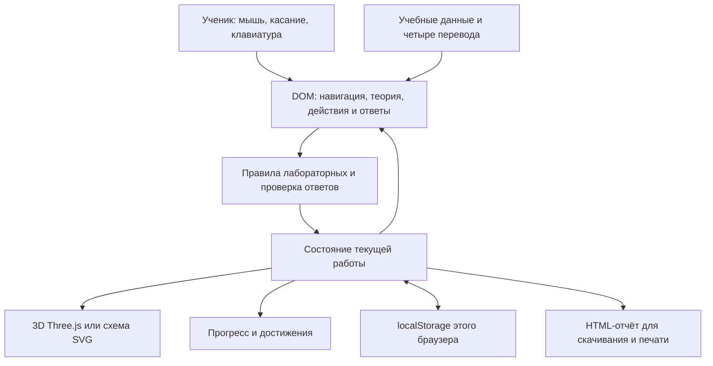

# Архитектура приложения

## Состав

Приложение — статический сайт на HTML, CSS и обычном JavaScript. React, TypeScript, серверная база и аккаунты в текущей реализации не используются. Скрипты загружаются локально из index.html в установленном порядке; общие функции и состояние доступны между скриптами. Такое решение позволяет запуск без сборки, но требует аккуратного контроля порядка загрузки и общих имён.

| Область | Файлы | Ответственность |
| --- | --- | --- |
| Навигация и экраны | [app.js](../src/app.js) | Маршруты hash, отображение, язык, привязка событий |
| Теория | [lesson-view.js](../src/lesson-view.js), [lesson-state.js](../src/lesson-state.js), src/lessons/ | Части урока, словарь, вопросы и проверка |
| Свойства веществ | [investigation.js](../src/curriculum/investigation.js), [table.js](../src/curriculum/table.js), [report.js](../src/curriculum/report.js) | 12 наблюдений, черновик таблицы, сравнение и отчёт |
| Физические явления | [physical.js](../src/curriculum/physical.js) | Парафин, соль, справочные описания запахов |
| Химические явления | [chemical.js](../src/curriculum/chemical.js) | Горение, окисление меди, карбонаты и кислота |
| Представление | [lab3d.js](../src/visual/lab3d.js), [styles.css](../src/styles.css) | Процедурные модели, камера, схема и адаптивная сетка |
| Сохранение и итоги | [storage.js](../src/storage.js), [progress.js](../src/curriculum/progress.js) | Настройки, попытки, достижения, продолжение |
| Публикация | [build_site.py](../tools/build_site.py), [pages.yml](../.github/workflows/pages.yml) | Упаковка только браузерных ресурсов и GitHub Pages |

## От действия к результату

Пример меди: подготовка → захват → нагрев → наблюдение чёрного слоя → выключение → охлаждение → сравнение → повторный нагрев и наблюдение → выключение → охлаждение → уборка. После действий ученик выбирает наблюдение и объяснение. Пройденность зависит от действий и ответов, а не от одного показа анимации.

Правила отклоняют неверный порядок с подсказкой. Пока активен источник, смена варианта блокируется. Отмена остановки не должна повторно зажигать источник. Камера меняет только обзор: поворот и масштаб не продвигают опыт. 3D отражает состояние той же модели, которая используется схемой и текстовыми наблюдениями.

## Хранение и достижения

Ключ `fotima.chemistry7.curriculum.v2` хранит настройки, чтение и ответы, записи образцов, отчёты, физические и химические попытки, достижения и последний учебный экран. Предыдущая демонстрационная версия переносит настройки, но не оценки. Недоступность хранилища показывается явно: продолжение в памяти возможно, сохранение после закрытия — нет.

Пять наград вычисляются по проверенным условиям. Награда за прошлое прохождение остаётся после сброса отдельной попытки; текущий статус при этом становится незавершённым. Общий сброс удаляет и историю наград. Это учебные отметки, не защищённый журнал аттестации. Заполнение 96 справочных полей первой работы само по себе не подтверждает правильность чисел и не даёт полного зачёта.

## Графика, доступность и зависимости

Three.js 0.160.1 загружается из локального файла, лицензия MIT и происхождение сохранены в assets/vendor. Модели созданы процедурно в проекте; сторонние модели из магазинов не использованы. Шрифт Inter поставляется локально с OFL. Нет внешнего CDN для графики.

Один canvas переиспользуется, непрерывного цикла отрисовки нет, плотность пикселей ограничена. При отсутствии WebGL или потере контекста доступна схема. Это меры экономии ресурсов, а не доказательство скорости на реальных телефонах. Нужные действия представлены DOM-кнопками; результат доступен текстом, не только цветом и звуком.

## Границы и развитие

Сохранение привязано к браузеру, устройству и адресу; синхронизации нет. При переходе с localhost на публичный сайт данные автоматически не переносятся. Имена и личные данные школьников не запрашиваются. Численные справки и свободные выводы не проверяются автоматически на научную правильность. Расширение классов потребует нового содержания и проверки, а не только добавления карточки. Ни новые классы, ни сервер в этом этапе не реализованы.
